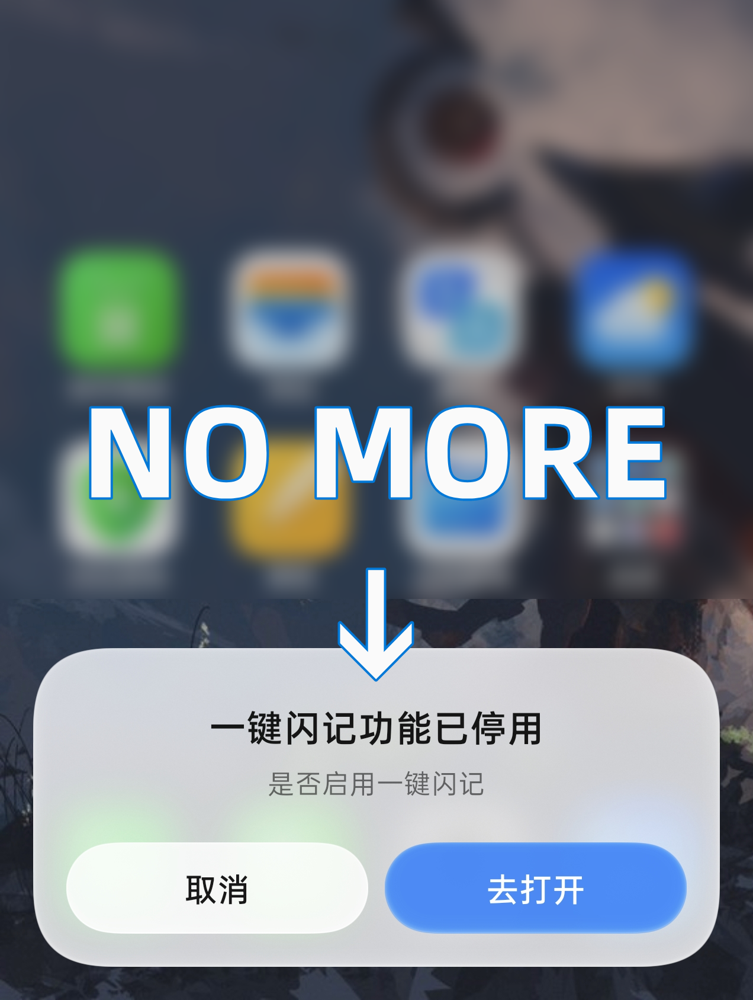

|   |   |
| - | - |

# 禁用ColorOS三指上滑一键闪记 | NoFlashMemory



## 简介！

在 ColorOS 中存在**三指上滑启动“一键闪记”**&#x7684;快捷手势，然而即使在各种地方关闭一键闪记之后，三指上滑的手势仍会触发并显示一个烦人的对话框（见上图），而且系统没有提供任何关闭这个提示框的办法。

本 Xposed / LSPosed 模块就是来拦截这个东西的（；´д｀）ゞ！！

- **作者**：LSDog, Hy4-flash ←白嫖 WorkBuddy 限免模型
- **适配系统**：ColorOS 17（理论上 ColorOS 16 也适用）

## 安装使用

1. 前往 [Releases](../../releases) 下载 `NoFlashMemory.apk` 并安装。
2. 本模块**没有桌面图标**。安装后，在 LSPosed 中启用模块 `禁用三指上滑一键闪记`，并勾选作用域 **「系统框架 (android) / System Framework」**。
3. 重启系统框架（直接软重启即可）。
4. 疯狂尝试三指上滑，什么都不会发生喵！

## 模块原理

### 问题根源

“一键闪记”（ColorOS 内部称 **Flash Memory / Gleaner / ColorDirect**）的三指上滑检测逻辑**位于 system_server 进程的 framework 层**。这解释了为什么在系统设置里关掉一键闪记开关后，弹框依旧出现——检测链路与开关是相互独立的。

通过实时 `logcat` 抓取到的真实触发链如下（进程 PID 为 system_server）：

```
OplusMultiPointerDetector.onTouchEvent           // 触摸事件入口，识别到 3 个指针
  └─ OplusMultiGestureThreeStrategy
       ├─ notifyThreeSwipeGesture(...)           // 三指滑动判定：算角度/方向
       ├─ onGestureMessage(Message)              // Handler 消息分发，MSG = 三指上滑
       ├─ handleThreeSwipeUp(int, int, Bundle)    // ★ 三指上滑专属触发入口
       │    └─ startColorDirectservice(Bundle, boolean)
       │         └─ 启动闪记服务 → 弹出「是否启用一键闪记」对话框
       └─ KeyLogTrack: trigger = THREE_FINGERS_UP // 上报埋点
```

### Hook 目标

| 项目     | 值                                                                                            |
| ------ | -------------------------------------------------------------------------------------------- |
| 类      | `com.android.server.oplus.input.exinputservice.globalgesture.OplusMultiGestureThreeStrategy` |
| 所在文件   | `/system/framework/oplus-services.jar`（`classes2.dex`）                                       |
| 宿主进程   | `system_server`（在 Xposed/LSPosed 中包名为 `android`）                                             |
| 日志 Tag | `GestureLog_OplusMultiGestureThreeStrategy`                                                  |

模块 hook 的方法：

1. **`handleThreeSwipeUp(int firstPointY, int isTouchPadEvent, Bundle pointBundle)`**  
   三指上滑的专属入口。在 `beforeHookedMethod` 中调用 `param.setResult(null)`，直接终止原方法体，让手势被静默吞掉，不再启动闪记服务、不再弹框。
2. **`startColorDirectservice(Bundle bundle, boolean isSupportGleanerApp)`**  
   闪记服务的启动点（经反编译验证：仅被 `handleThreeSwipeUp` 调用）。同样拦截作为双保险，防止系统 OTA 后调用链发生变化时仍能弹出对话框。

### 并不影响其他手势

三指手势由 `OplusMultiGestureThreeStrategy` 统一检测，但**每种手势的触发是独立的方法**：

- 三指下滑截图 → `handleThreeSwipeDown(...)`
- 三指左滑 / 右滑 → `handleThreeSwipeLeft()` / `handleThreeSwipeRight()`
- 三指长按 → `handleThreeLongPress(...)`

本模块只拦截 `handleThreeSwipeUp` 与 `startColorDirectservice`，不触碰上述方法，也不修改触摸事件本身，因此**其余手势（包括其他三指手势）行为完全不变**。

### 核心代码

见 [`app/src/main/java/fun/lsdog/noflashmemory/HookEntry.java`](app/src/main/java/fun/lsdog/noflashmemory/HookEntry.java)

### 自行编译

项目为标准 Android Gradle 工程：

```bash
git clone <this-repo>
cd NoFlashMemory
./gradlew assembleRelease
# 产物：app/build/outputs/apk/release/app-release.apk
```

Xposed API 以 `compileOnly` 方式依赖（见 `libs/xposed-api.jar`），运行时由 LSPosed 提供。

## 其他

- **AI 声明**：本模块代码完全由 AI 完成（Hy4 flash）。
- **授权**：仅供学习交流，请勿用于非法用途。
